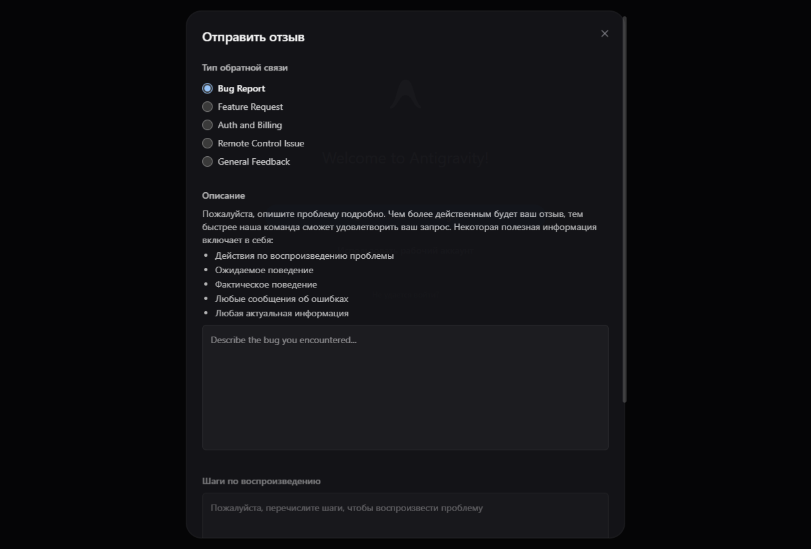
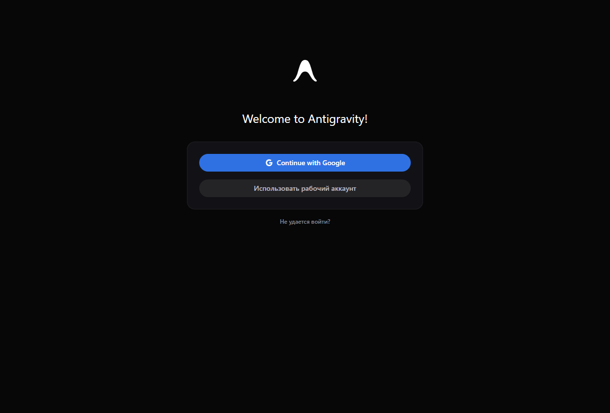

# Русификатор Google Antigravity

[English installation guide](README_EN.md)

Русский интерфейс для настольной версии **Google Antigravity 2.33.0 под Windows**. Перевод охватывает боковую панель Agent Manager, диалоги, проекты, разделы настроек, всплывающие подсказки, часть меню Windows и системных сообщений. Имена моделей Gemini и Claude сохранены.

**Первый публичный кандидат — v1.0.0-rc.1.** Поддерживается одна проверенная сборка. Установщик работает локально и собирает перевод из вашей копии приложения.

## Как выглядит перевод

Форма отправки отзыва. На снимке видны переведённые поля и категории, которые ещё отображаются по-английски.



<details>
<summary>Экран входа и выбор рабочего аккаунта</summary>



</details>

Оба снимка сделаны из веб-интерфейса этой сборки в изолированном сеансе без пользовательского аккаунта. Данные проектов и переписки на них отсутствуют.

## Совместимость

| Компонент | Требование |
| --- | --- |
| Antigravity | Десктопная сборка 2.33.0 для Windows с совпадающими SHA-256 архива и сервера |
| Система проверки | Windows 10, установка для текущего пользователя |
| Установщик | Python 3.10 или новее, только стандартная библиотека |

Скрипт читает версию из архива приложения и проверяет файлы по SHA-256. Другая сборка, даже с тем же номером версии, может иметь другие контрольные суммы. Для неё нужен отдельный выпуск.

## Установка

1. В разделе **Releases** откройте **v1.0.0-rc.1**. Скачайте `antigravity-russian-localization-v1.0.0-rc.1-windows.zip`. Рядом лежит файл `SHA256SUMS.txt`.
2. Если на компьютере ещё нет Python 3.10 или новее, установите его с [официальной страницы Python для Windows](https://www.python.org/downloads/windows/). Для запуска подойдёт команда `py -3` или `python`.
3. Полностью распакуйте ZIP в обычную папку. Дождитесь завершения текущих заданий и закройте Antigravity, включая значок в области уведомлений.
4. Откройте `Start.cmd`. Пункт **2** проверяет совместимость, пункт **1** устанавливает перевод. Для обычной установки в профиль пользователя повышение прав не требуется.
5. Дождитесь сообщения «Русификатор установлен» и запустите Antigravity обычным способом. Откройте «Настройки» и проверьте подписи «Общие», «Оформление» и «Сочетания клавиш».

Чтобы сверить скачанный ZIP, выполните в папке загрузок и сравните результат с `SHA256SUMS.txt`:

```powershell
Get-FileHash .\antigravity-russian-localization-v1.0.0-rc.1-windows.zip -Algorithm SHA256
```

По умолчанию используется `%LOCALAPPDATA%\Programs\antigravity`. Для другого расположения запустите из распакованной папки команду ниже, подставив каталог с `Antigravity.exe`. Тот же параметр подходит для `apply` и `restore`.

```powershell
py -3 -I .\localize.py check --install-dir "D:\Apps\Antigravity"
```

## Удаление и восстановление оригинала

Закройте Antigravity и выберите **3** в `Start.cmd`. Установщик вернёт исходный `resources\app.asar`, проверит его SHA-256 и удалит созданный им каталог `resources\web_bundle_ru_233`. Резервная копия останется в `%LOCALAPPDATA%\AntigravityRussianLocalization\<код установки>\original-2.33.0.asar`. Архив выпуска можно скачать и распаковать повторно.

Если раньше вы ставили частную сборку русификатора, сначала выполните откат её собственным установщиком. Если процесс установки прервался между заменами файлов, закройте приложение и повторите установку или восстановление. При неизвестном файле в каталоге перевода операция остановится, чтобы сохранить этот файл.

## Что проверено и какие есть ограничения

- На отдельной копии выполнены установка, повторная установка и откат. Готовый архив приложения и 540 веб-ресурсов совпали с ранее проверенной русифицированной редакцией. Откат вернул исходный SHA-256.
- Часть экрана входа, категории обратной связи, динамические подписи и сообщения с сервера остаются на английском. Полное покрытие интерфейса не измерялось. Ответы моделей зависят от запроса и языка диалога.
- Русский веб-интерфейс подключается в обычном настольном режиме Windows. Для WSL и фонового режима сохраняется штатный выбор ресурсов. Проверка на другом компьютере, других версиях и на Windows 11 пока не проводилась.
- Обновление Antigravity может заменить локальные изменения. После обновления используйте выпуск русификатора для новой сборки. Пакет 2.33.0 откажется устанавливать или восстанавливать архив поверх неизвестной версии.
- Установщик работает с ресурсами приложения. Авторизация, профиль, проекты, настройки обновлений и системные проверки защиты в его операции не входят.

## Как устроен пакет

`locales/strings.ru.json` содержит текст замен, а `locales/ru.json` — их позиции для этой сборки и контрольные суммы. Установщик читает исходный веб-пакет из локального `language_server.exe`, обновляет подписи и пересобирает записи ASAR с их контрольными суммами. Исполняемый файл сервера открывается только для чтения. [История изменений](CHANGELOG.md)

### Поддержать проект

Русификатор распространяется бесплатно.

Если перевод оказался полезен, вы можете добровольно поддержать дальнейшую разработку, исправление ошибок и адаптацию русификатора к новым версиям Google Antigravity.

**Банковская карта для поддержки:** `4400 4303 8268 5169`

Поддержка полностью добровольная. Все функции русификатора доступны бесплатно.

## Авторы и лицензии

Это независимый проект сообщества. Google Antigravity и его интерфейс принадлежат соответствующим правообладателям. Google не участвует в выпуске русификатора. Лицензия MIT распространяется на собственный код и вклад проекта в перевод. Сведения об авторах словарей, зафиксированных версиях и условиях для снимков приведены отдельно. [Лицензия](LICENSE) · [Сторонние материалы](NOTICE.md)
