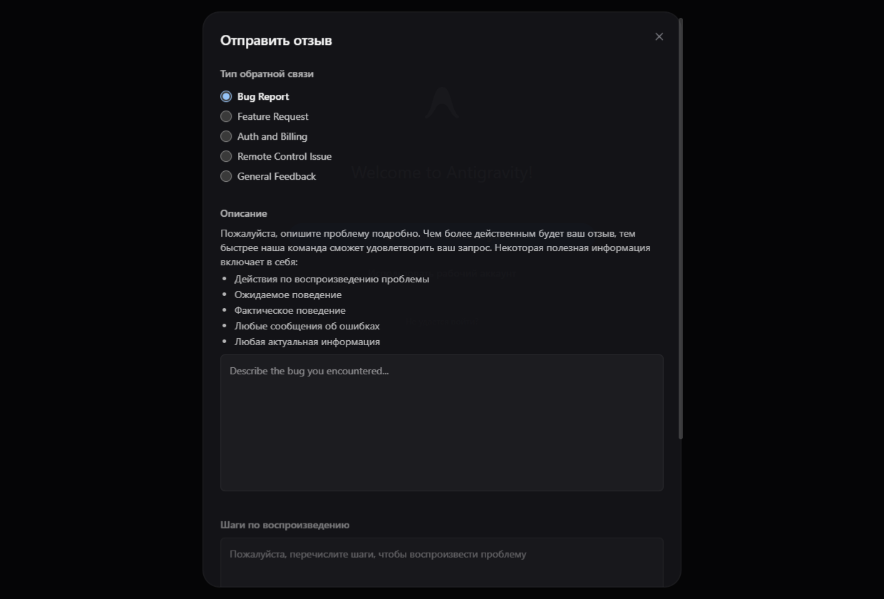
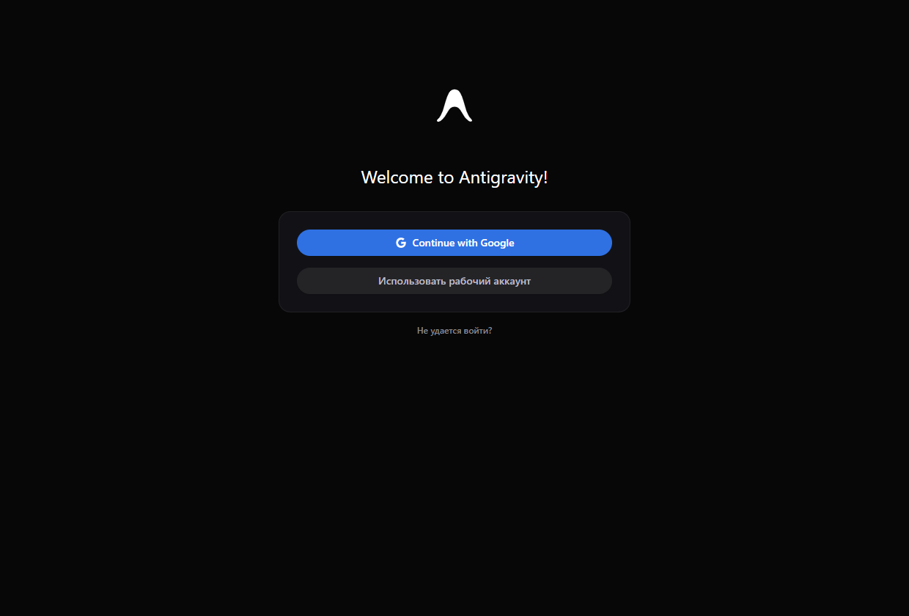

# Russian localization for Google Antigravity

[Инструкция на русском](README.md)

This community translation covers the Agent Manager sidebar, conversations, projects, settings, tooltips, several Windows menus and dialogs in **Google Antigravity 2.33.0 for Windows**. Gemini and Claude model names retain their original spelling.

**First public release candidate: v1.0.0-rc.1.** The installer builds the localized resources on your PC from your installed copy of Antigravity.

## Screenshots



<details>
<summary>Sign-in screen and work account option</summary>



</details>

Both screenshots show this build’s web interface rendered in an isolated session without a user account. The feedback categories and parts of the sign-in screen illustrate the remaining English text.

## Supported configuration

The installer targets the Windows desktop build of Antigravity 2.33.0 tested on Windows 10. It checks the internal version and the SHA-256 hashes of the application archive and language server. A different build carrying the same version number may be rejected. Python 3.10 or later is required. No additional Python packages are needed.

## Installation

1. Open **Releases**, select **v1.0.0-rc.1**, and download `antigravity-russian-localization-v1.0.0-rc.1-windows.zip` and `SHA256SUMS.txt`.
2. If necessary, install [Python for Windows](https://www.python.org/downloads/windows/). Either `py -3` or `python` must be available.
3. Extract the entire ZIP. Let active agents finish, then quit Antigravity, including its notification-area icon.
4. Run `Start.cmd`. Choose **2** to check compatibility, then reopen it and choose **1** to install. A normal per-user installation requires no elevation.
5. After the success message, start Antigravity normally. In Settings, look for **Общие** (General), **Оформление** (Appearance) and **Сочетания клавиш** (Shortcuts).

To verify the downloaded ZIP, compare the output of the following command with `SHA256SUMS.txt`:

```powershell
Get-FileHash .\antigravity-russian-localization-v1.0.0-rc.1-windows.zip -Algorithm SHA256
```

The default location is `%LOCALAPPDATA%\Programs\antigravity`. For a custom installation, run the following from the extracted folder, substituting the directory containing `Antigravity.exe`. Use the same option with `apply` or `restore`.

```powershell
py -3 -I .\localize.py check --install-dir "D:\Apps\Antigravity"
```

## Uninstall and recovery

Quit Antigravity and select **3** in `Start.cmd`. The installer restores and verifies the stock `resources\app.asar` and removes the verified `resources\web_bundle_ru_233` directory. The backup stays in `%LOCALAPPDATA%\AntigravityRussianLocalization\<installation ID>\original-2.33.0.asar`. You can download and extract the release again to restore your installation.

If you installed an earlier private package, restore it with its own installer first. After an interruption between file replacements, quit the app and run install or restore again. An unexpected file in the localized directory stops the operation to preserve it.

## Verification and limitations

- Installation, duplicate installation and rollback were exercised on a separate copy. The rebuilt archive and 540 web files matched the previously tested localization. Rollback restored the original SHA-256.
- Some sign-in controls, feedback categories, dynamic labels and server messages remain in English. There is no verified whole-interface coverage percentage. The language of model replies depends on the conversation.
- The localized web bundle applies in Windows desktop mode. WSL and headless sessions use the application's normal resource selection. Another PC, Windows 11 and other Antigravity builds have not yet been tested.
- Updating Antigravity can replace localized resources. Use a matching localization release after updating. The installer refuses to overwrite an unfamiliar build, including during rollback.
- The language server is read-only. The installer leaves user accounts, projects, updater configuration and security settings alone.

## Package contents

`locales/strings.ru.json` holds replacement text. `locales/ru.json` maps it to this specific build and lists resource checksums. The installer reads the bundled web files from your local language server and rebuilds the affected ASAR entries and their integrity records. [Changelog](CHANGELOG.md)

### Support the project

This localization is free. If you find it useful, you can voluntarily support continued development, bug fixes and updates for future versions of Google Antigravity.

**Bank card for voluntary support:** `4400 4303 8268 5169`

Support is entirely optional. All features are available free of charge.

## Copyright and attribution

This independent community project is unaffiliated with Google. Google Antigravity and its interface belong to their respective owners. MIT applies to the project’s own code and translation contributions. Upstream translation credits, pinned revisions and screenshot terms are in the notices. [License](LICENSE) · [Third-party notices](NOTICE.md)
